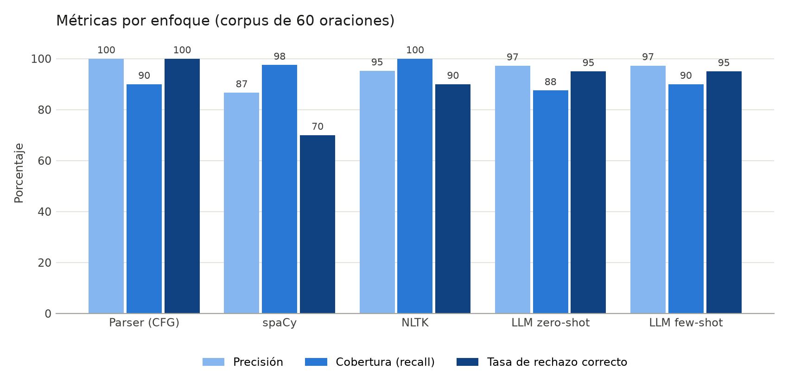
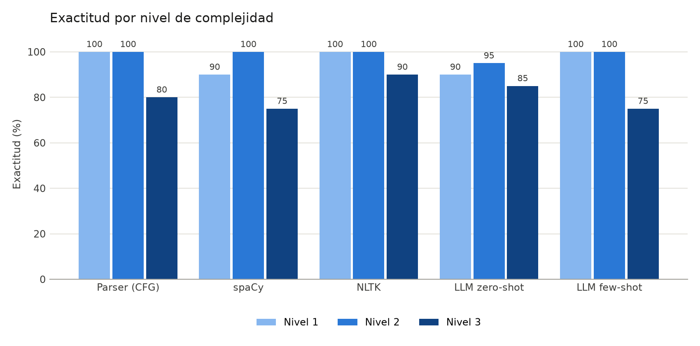

# Gramáticas formales y lenguaje natural
## Fase 2. Comparación experimental de una CFG, herramientas de NLP y un LLM

**Universidad Centroamericana José Simeón Cañas** · Facultad de Ingeniería y Arquitectura

Teoría de Lenguajes de Programación · TLP02-2026 · Grupo 8

| Integrante | Carné | Responsabilidad |
| --- | --- | --- |
| Carlo Enrique Guerra Vega | 00052220 | P1: parser |
| Federico Josué Calderón Durán | 00215818 | P2: gramática y corpus |
| Kelvin Rodrigo Iraheta Morales | 00083121 | P3: NLP y evaluación |
| Allan Josué López Escalante | 00049222 | P4: LLM e integración |

Docente: Jaime Roberto Clímaco Navarrete. Antiguo Cuscatlán, 18 de noviembre de 2026.

### Resumen

Se comparan cuatro familias de enfoques sobre 60 oraciones: un parser con una gramática libre de contexto (CFG), spaCy con reglas de concordancia, un etiquetador NLTK con reglas y Gemini 3.1 Flash-Lite mediante API, en zero-shot y few-shot. Se separan dos objetivos: corrección en español y pertenencia al lenguaje de la CFG. La gramática genera 36 de las 40 oraciones etiquetadas como correctas; sus cuatro exclusiones son de cobertura estructural y no de vocabulario.

El parser alcanza 93,3 % de exactitud frente al español; spaCy, 88,3 %; NLTK, 96,7 %; y el LLM, 90,0 % en zero-shot y 91,7 % en few-shot. El cambio más importante del LLM aparece en fidelidad a la CFG: 90,0 % frente a 98,3 %. Few-shot rechaza las cuatro construcciones correctas en español que la gramática no genera y reduce de 25 a 6 los árboles incorrectos entre verdaderos positivos. Sin embargo, todavía acepta un caso con desacuerdo de número y produce derivaciones inválidas.

La evidencia favorece una conclusión acotada: los ejemplos mejoraron el seguimiento de esta especificación, sin convertir al LLM en un parser con garantías formales. Los cinco logs, el corpus y el evaluador permiten reproducir las cifras sin nuevas consultas de API.

**Lectura del documento.** Páginas 1–10: informe principal. Después: índice de anexos, corpus etiquetado y prompts exactos ilustrados con el ID 1. Los archivos completos de evidencia se adjuntan al PDF y se incluyen en el ZIP de entrega.

<!-- PAGE -->
# 1. Parser propio y CFG del español controlado

El parser reutiliza el motor de la Fase 1: descenso recursivo con backtracking que explora las producciones y devuelve todos los árboles que consumen la entrada completa. Ningún árbol implica rechazo; uno implica aceptación; más de uno indica ambigüedad. El motor se importa desde `fase1/motor.py` y recibe la gramática de `fase2/gramatica_es.py`; no se copia ni se añade un corrector externo de concordancia [1].

La CFG tiene 57 no terminales, 207 producciones y 47 terminales léxicos. Sus categorías distinguen género y número nominales y persona, número y tiempo verbales. Por ejemplo, `sn_ms` expande a `det_ms n_ms mod_ms`, y un sujeto nominal singular combina con un predicado singular. La concordancia está codificada mediante categorías de una CFG de Tipo 2, no mediante comprobaciones imperativas posteriores.

| Construcción | Representación o alcance |
| --- | --- |
| Orden básico | Sujeto y predicado; verbo transitivo con objeto |
| Concordancia | Categorías ms, fs, mp, fp y número verbal |
| Tiempo y persona | Presente y pretérito; tercera y primera persona |
| Modificadores | Adjetivos, adverbios y SP con «en» o «con» |
| Subordinación | Relativas de sujeto y de objeto, también anidadas |
| Restricciones de cobertura | Negación y coordinación limitadas a alternativas explícitas |

Antes de analizar, el motor convierte el texto a minúsculas, elimina puntos y comas y separa por espacios. Conserva tildes y otros signos. Así, el punto final del corpus no es una hoja del árbol. Todos los terminales del corpus pertenecen al vocabulario: ningún rechazo observado se explica por una palabra desconocida.

La gramática acepta 36 oraciones y rechaza 24. Rechaza correctamente las 20 negativas del corpus y excluye las correctas 49–52 por producciones ausentes. La 47, «El perro come la carne en la casa.», tiene dos derivaciones: el sintagma preposicional modifica el objeto o el predicado. La ambigüedad es una propiedad del análisis, no un fallo de clasificación.

Frente a las 93 producciones de la gramática extendida de Fase 1, las 207 actuales muestran el costo práctico de escribir más combinaciones de rasgos. Este crecimiento y los rechazos de cobertura no demuestran que esas construcciones sean imposibles de expresar con una CFG: agregar producciones permitiría cubrirlas. La conclusión se refiere a esta gramática concreta.

<!-- PAGE -->
# 2. Corpus y dos criterios de referencia

P2 construyó un corpus manual de 60 oraciones distintas, con 40 positivas y 20 negativas. El CSV contiene `id`, `oracion`, `nivel`, `esperado` y `arbol_esperado`. Los IDs enlazan todos los logs. `esperado` representa corrección en español, no la respuesta del parser. Los árboles de 49–52 describen estructuras españolas mediante categorías que no forman parte de la CFG [1].

| Nivel | Correctas | Incorrectas | Total | Criterio de selección |
| --- | ---: | ---: | ---: | --- |
| 1: simples | 14 | 6 | 20 | Concordancia básica, pretérito y pronombres |
| 2: intermedias | 14 | 6 | 20 | Adjetivos, adverbios, objetos y SP |
| 3: complejas | 12 | 8 | 20 | Relativas, anidamiento, ambigüedad y exclusiones |
| Total | 40 | 20 | 60 | Mismo conjunto para los cinco logs |

Las oraciones simples permiten comprobar aceptación y rechazo básicos. Las intermedias combinan modificadores y objetos dentro de la cobertura prevista. Las complejas examinan relativas, concordancia a distancia y adjunción; además incluyen construcciones españolas correctas que faltan en la especificación. Los niveles se asignaron por fenómeno, no solo por longitud.

El corpus usa 40 de las 47 palabras de la CFG. No contiene duplicados después de normalizar y no hay palabras desconocidas para el parser. Esto elimina dos problemas del borrador anterior: una oración repetida pesaría dos veces y un terminal ausente impediría aislar una limitación estructural. Un tercio del conjunto es negativo; cada error entre esas 20 entradas mueve cinco puntos porcentuales la tasa de rechazo correcto.

### Español frente a lenguaje generado

Hay dos referencias. La primera es la etiqueta humana `esperado`: una oración correcta en español es positiva aunque la CFG la excluya. La segunda se calcula con todas las derivaciones del motor: es positiva solo si pertenece al lenguaje de la gramática. Por ello, rechazar 49–52 genera falsos negativos en la tabla española y aciertos en fidelidad a la CFG. Esta distinción sostiene la pregunta sobre obediencia formal del LLM.

Las negativas se concentran en concordancia nominal y verbal, incluida la distancia entre antecedente y verbo. Sin embargo, 59 y 60 también involucran posición del adjetivo y enlace entre verbos. No se caracterizan todas las negativas como errores exclusivamente de concordancia. El corpus es una muestra diseñada para estos fenómenos y no representa la distribución del español real. No hay un conjunto externo de validación: las conclusiones describen este experimento, no una superioridad general de los enfoques.

<!-- PAGE -->
# 3. Metodología común y herramientas de NLP

Se conservaron cinco logs JSON sobre el mismo CSV: parser, spaCy, NLTK, LLM zero-shot y LLM few-shot. Cada uno contiene metadatos y resultados por ID. El evaluador verifica la cobertura de IDs y la identidad literal de las oraciones antes de calcular métricas. Los registros brutos se mantienen separados de las interpretaciones; la ausencia de un archivo no se sustituye con resultados inventados [1].

### Parser y spaCy

El parser ejecuta la CFG con el motor ya descrito; guarda veredicto, primer árbol, cantidad de árboles, motivo del rechazo y tiempo. Su log registra Python 3.12.10 y NLTK 3.10.3. La referencia de pertenencia a la CFG se recalcula en el evaluador con ese mismo motor, por lo que su fidelidad del 100 % es por construcción, no una validación independiente.

spaCy 3.8.18 utiliza `es_core_news_md` 3.8.0, un pipeline de español para texto de noticias [2]. Recibe las oraciones con su mayúscula y puntuación originales. Una regla propia, importada de `fase1/tabla_nlp.py`, busca contradicciones de género o número entre sustantivo, determinante y adjetivo, y de número entre sujeto y verbo. Detectar una contradicción produce rechazo; no detectarla produce aceptación. Si faltan los rasgos o la relación correcta, la regla puede dejar pasar un error. Se evalúa el sistema «spaCy + regla», no un juicio nativo de gramaticalidad de spaCy.

### NLTK y adaptación de sus etiquetas

Se entrenó un etiquetador secuencial en cadena: BigramTagger, con UnigramTagger y RegexpTagger de sufijos como respaldo [3]. P3 usó `cess_esp`: 6.030 oraciones y 188.802 palabras etiquetadas. El entrenamiento con el 90 % inicial y prueba con el 10 % final dio 86,2 % de exactitud de etiquetado; el etiquetador aplicado al experimento se entrenó con el 100 %. Ese 86,2 % no es la exactitud de aceptación del corpus del proyecto.

Las etiquetas EAGLES permiten extraer género y número. El adaptador verifica grupos nominales por posición, relaciones de relativas y el primer verbo principal; también reconoce un sujeto coordinado como plural. Es más elaborado que el adaptador de spaCy. Las entradas se normalizan a minúsculas y se tokenizan sin puntuación. Los tres errores de etiquetado entre aciertos incluyen «duermo», «como» y «nosotras», por palabras desconocidas o por la categoría predominante en el entrenamiento.

En los errores de spaCy destacan 15 y 17: «perro» como nombre propio sin género útil; 56, 57 y 59: relaciones mal resueltas entre elementos separados; y 60: dos verbos sin enlace. El FN 49 proviene de la regla de sujeto coordinado. NLTK deja pasar 59 y 60 porque su adaptador no relaciona el adjetivo alejado ni detecta el segundo verbo sin enlace.

Se reutilizan los logs completos de P1/P3 y sus versiones registradas. La evaluación final usa Python 3.12.14, NLTK 3.10.3 y matplotlib 3.11.2. No se volvió a entrenar NLTK ni se regeneraron las salidas de esas herramientas al integrar el informe.

<!-- PAGE -->
# 3.1. Experimento del LLM por API

Se consultó la API de Google desde Python, mediante solicitudes HTTP independientes a `generateContent`. El modelo solicitado y devuelto en las 120 respuestas fue `gemini-3.1-flash-lite` [4]. La clave se cargó de `GEMINI_API_KEY` en el entorno o `.env` local y no se incluyó en prompts ni logs.

| Parámetro | Configuración idéntica en ambas variantes |
| --- | --- |
| API y modelo | v1beta; gemini-3.1-flash-lite |
| Temperatura solicitada | 0 |
| Máximo de salida | maxOutputTokens = 2048 |
| Razonamiento | thinkingLevel = MINIMAL |
| Contexto de cada solicitud | Un mensaje de usuario, sin historial ni herramientas |
| Diseño | 60 zero-shot y 60 few-shot; 18 nov 2026 |
| Formato solicitado | JSON con salida y arbol; null al rechazar |

Zero-shot incluye las instrucciones comunes, el contenido íntegro de `gramatica_es.txt` y una oración. Few-shot inserta cinco demostraciones fijas antes de esa oración. No se envían el nivel, la etiqueta humana, el árbol esperado ni los resultados de otros enfoques. Se pregunta si existe una derivación de la CFG, no si la oración «suena correcta». Los prompts completos del ID 1 se imprimen en los anexos C y D; los 120 prompts exactos están en los logs.

Las demostraciones son tres aceptaciones y dos rechazos: pretérito con adverbio; primera persona con objeto; relativa de objeto; discordancia de adjetivo; y negación con objeto correcta en español pero ausente de la CFG. Se comprobó que ninguna coincide con el corpus, incluso tras normalizar. El último ejemplo enseña un fenómeno próximo al ID 52: se declara este apoyo al interpretar el efecto few-shot.

El corredor guarda prompt y timestamp UTC antes del envío y la respuesta HTTP completa antes de interpretarla. JSON ilegible, árbol sintácticamente ilegible o respuesta incompleta producen `invalida`; una decisión equivocada o una derivación legible que viola reglas conservan el veredicto del modelo. No se reparan respuestas. La validación adicional revisa raíz, producciones y hojas.

Se conservaron 163 intentos: 120 respuestas y 43 errores operativos, 42 HTTP 503 y un 429. Los 503 se reanudaron con pausas limitadas; el 429 se revisó antes de continuar. Se redujo la frecuencia a cinco segundos entre respuestas y se pospusieron casos con más fallos de servicio sin excluirlos. Las respuestas existentes, incluidas las inválidas, no se repitieron. Ningún error HTTP se contó como rechazo lingüístico. La latencia remota y las pausas no son equivalentes al tiempo de cómputo local del parser. Se hizo una corrida por variante: temperatura solicitada 0 no garantiza respuestas repetibles y un acierto neto adicional no demuestra significación estadística.

<!-- PAGE -->
# 3.2. Métricas y criterios de comparación

Se considera positiva la salida `acepta`. Frente a la etiqueta española, VP es una oración correcta aceptada, FN una correcta rechazada, FP una incorrecta aceptada y VN una incorrecta rechazada. Una salida `invalida` siempre cuenta como error: FN en una positiva y FP en una negativa. Así se mantienen las 60 entradas en el denominador y no se favorece a quien incumple el formato.

| Medida | Fórmula o regla | Interpretación |
| --- | --- | --- |
| Exactitud | (VP + VN) / 60 | Fracción total de decisiones correctas |
| Precisión | VP / (VP + FP) | Corrección entre las decisiones positivas |
| Cobertura (recall) | VP / (VP + FN) | Positivas de referencia recuperadas |
| Rechazo correcto | VN / (VN + FP) | Negativas rechazadas correctamente |
| Fidelidad a la CFG | Decisiones iguales a pertenencia CFG / 60 | Seguimiento del lenguaje especificado |

La fidelidad acepta solo `acepta` para cadenas con alguna derivación y `rechaza` para las demás. `invalida` no es fiel. El español etiqueta 40 positivas; la CFG genera 36. La fidelidad de spaCy y NLTK es informativa: esas herramientas no reciben la especificación y no fueron instruidas para seguirla.

### Etiquetado y estructura del árbol

El evaluador extrae categorías por palabra del árbol esperado y traduce cada sistema a un inventario común: determinante, nombre, nombre propio, pronombre, verbo, adjetivo, adverbio, preposición, conjunción y «que». Cuenta una oración con error de etiquetado si es VP y alguna categoría difiere. No es una tasa de error por token ni una evaluación completa de rasgos morfológicos.

Para parser y LLM, el árbol completo se compara con el esperado y con todas las derivaciones de la CFG. Cualquiera de los dos árboles válidos de la 47 se admite. Se normalizan espacios, pero no se quitan comillas de las hojas ni se inventan nodos epsilon. Los árboles de dependencias de spaCy y las etiquetas POS de NLTK no se comparan como árboles de constituyentes; la medida estructural figura como no aplicable.

La auditoría adicional de P4 revisa toda aceptación del LLM, incluidas las falsas positivas, mediante raíz, producciones y hojas. Su denominador difiere del evaluador, que cuenta árboles distintos solo entre VP. Además, la fidelidad de un veredicto no certifica la derivación: el modelo puede aceptar una oración que pertenece a la CFG y aun así construir un árbol inválido.

Todas las cifras principales se toman de `fase2/resultados/tablas.md`. Las cuentas enteras se conservan en CSV y los porcentajes se muestran con un decimal. El mismo evaluador, sin modificaciones, procesa los cinco logs.

<!-- PAGE -->
# 4. Resultados cuantitativos

La Tabla 1 compara las cinco variantes sobre las mismas 60 oraciones. NLTK más su adaptador obtiene la mayor exactitud española, 58/60. El parser clasifica 56/60 sin falsos positivos; sus cuatro fallos son exclusiones de cobertura. El LLM alcanza 54/60 con zero-shot y 55/60 con few-shot.

{{METRICAS}}

**Tabla 1.** Métricas frente a la etiqueta española. Fuente: `resultados/tablas.md`. Precisión, cobertura y rechazo correcto se definen en la página anterior.



La comparación muestra perfiles diferentes. El parser rechaza todas las negativas y cubre 36/40 positivas. spaCy cubre 39/40, pero acepta seis negativas. NLTK cubre las 40 positivas y deja pasar dos negativas. Ambas variantes del LLM dejan pasar una negativa; few-shot recupera una positiva neta más que zero-shot.

Estos resultados no prueban superioridad general de una biblioteca. Los adaptadores de spaCy y NLTK incorporan reglas distintas y el corpus se diseñó con vocabulario reducido. Además, «correcta en español» y «generada por la CFG» tienen respuestas diferentes en cuatro entradas. La comparación de fidelidad a las reglas se presenta por separado.

<!-- PAGE -->
# 4.1. Errores y resultados por nivel

{{ERRORES}}

**Tabla 2.** Clasificación de errores. Los errores de etiquetado y de árbol se cuentan entre verdaderos positivos y pueden coexistir con un acierto de clasificación; no se suman a FP y FN para obtener el total de fallos. n/a: no aplicable al tipo de salida.



En niveles 1 y 2, few-shot clasifica 20/20 en cada uno, frente a 18/20 y 19/20 de zero-shot. En nivel 3 baja de 17/20 a 15/20. Esta disminución no significa peor obediencia: los rechazos nuevos de 50 y 52 cumplen la CFG, aunque la etiqueta española los cuente como FN.

La mejora estructural del LLM es mayor que el cambio de exactitud: de 25 a 6 árboles incorrectos entre VP y de tres respuestas inválidas a ninguna. En el parser, los 36 VP tienen árboles correctos. La fila de etiquetado permite comparar categorías comunes, pero no reemplaza la validación de producciones.

<!-- PAGE -->
# 5. Análisis del LLM frente a las reglas

{{FIDELIDAD}}

**Tabla 3.** Fidelidad del veredicto a la CFG. El parser es referencia por construcción; las herramientas NLP no recibieron las reglas y su coincidencia es solo descriptiva.

| ID | Correcta en español, pero fuera de la CFG | Zero-shot | Few-shot |
| --- | --- | --- | --- |
| 49 | El perro y la gata duermen. | rechaza | rechaza |
| 50 | El perro come la carne y duerme. | acepta | rechaza |
| 51 | El perro duerme y la gata come. | rechaza | rechaza |
| 52 | El perro no come la carne. | acepta | rechaza |

Zero-shot acepta 50 y 52 sin una derivación permitida. Eso es evidencia observable de incumplimiento de las reglas, compatible con usar patrones generales del español; la salida no permite demostrar el mecanismo interno del modelo. Few-shot rechaza las cuatro y mejora cinco decisiones de fidelidad en total: 54/60 a 59/60.

Los otros tres cambios son los IDs 4, 11 y 26: respuestas inválidas en zero-shot que few-shot convierte en aceptaciones correctas. Por eso la exactitud española gana solo un caso neto: tres recuperaciones menos los dos rechazos nuevos de 50 y 52. Los ejemplos mejoran el objetivo formal aunque la tabla española no premie todos esos cambios.

### La decisión correcta todavía puede tener un árbol incorrecto

La auditoría formal encuentra 10 árboles válidos en las 36 aceptaciones de zero-shot y 30 en las 37 de few-shot. El 98,3 % de fidelidad de few-shot no es una tasa de árboles correctos. En la 47 ambos aceptan, pero zero-shot usa una expansión de `sn` inexistente y few-shot introduce `(mod_fs (mod_ms))`; no se penaliza una lectura ambigua alternativa, sino producciones inválidas.

El ID 56 es el único FP de ambas variantes: «El perro negro que comen duerme.». Few-shot escribe `(v_s comen)`, pese a que «comen» es plural en la gramática. Zero-shot además inserta palabras ausentes de la entrada. Este caso impide afirmar seguimiento perfecto. Zero-shot también usa comillas literales en hojas y anidamientos epsilon inexistentes; los nodos sin etiqueta de 4, 11 y 26 se conservaron como inválidos, sin reparación manual.

<!-- PAGE -->
# 6. Conclusiones y reproducción

**1. La CFG cubre una parte precisa del corpus con garantías de derivación.** Clasifica 56/60 frente al español, rechaza las 20 negativas y produce árboles correctos para sus 36 aceptaciones. Sus cuatro exclusiones son de cobertura de esta gramática. Las 207 producciones muestran el trabajo necesario para representar combinaciones de rasgos; el experimento no demuestra que todo el español quede fuera de Tipo 2.

**2. El LLM mejora con ejemplos en esta especificación.** Few-shot alcanza 59/60 decisiones fieles a la CFG frente a 54/60 de zero-shot. Rechaza 49–52, reduce inválidas de tres a cero y árboles incorrectos entre VP de 25 a 6. La exactitud española cambia de 54/60 a 55/60; medir solo esa cifra ocultaría buena parte de la mejora formal.

**3. Ningún indicador aislado sustituye el análisis.** El LLM aún falla en 56 y construye árboles inválidos. NLTK más reglas logra 58/60, pero con ventajas del adaptador y del corpus; spaCy cubre 39/40 positivas a costa de aceptar seis negativas. La elección práctica depende de si se requiere cobertura, rechazo estricto o una derivación verificable.

### Reproducción sin nuevas llamadas a la API

Desde la raíz de la copia entregada, con Python 3.10 o posterior:

```powershell
python -m venv .venv
.\.venv\Scripts\python.exe -m pip install -r requirements.txt
.\.venv\Scripts\python.exe fase2/evaluar.py
```

El evaluador utiliza los cinco logs guardados y genera tres CSV, las tablas Markdown y dos PNG. No requiere clave de API. Dos ejecuciones locales dieron seis archivos idénticos byte a byte; las huellas se conservan en `07_auditoria_corrida.json`. Para generar datos nuevos se documentan los corredores en `fase2/README.md`; no se deben reemplazar los logs de esta corrida. Si la descarga opcional de `cess_esp` falla por proxy, configurar `NLTK_ALLOW_PROXIED_URLOPEN=1`.

### Referencias y evidencia

[1] Equipo TLP02-2026, Grupo 8 (2026). Código, corpus y documentación 01–04 de Fase 2. Repositorio: https://github.com/iamcarlogg/ProyectoTLP2026. Versión de trabajo identificada por las huellas anexas; los cambios de P4 se incluyen en el ZIP.

[2] Explosion. Spanish pipelines, `es_core_news_md`. https://spacy.io/models/es#es_core_news_md.

[3] NLTK Project. Sequential backoff taggers. https://www.nltk.org/api/nltk.tag.sequential.html.

[4] Google. Gemini 3.1 Flash-Lite; precios de Gemini API. https://ai.google.dev/gemini-api/docs/models/gemini-3.1-flash-lite y https://ai.google.dev/gemini-api/docs/pricing. Fuentes web consultadas el 18 de noviembre de 2026. El uso reportado suma 351.998 tokens de entrada y 6.381 de salida visible, equivalente a USD 0,097571 a tarifa estándar; no confirma cargos efectivos o créditos aplicados.
